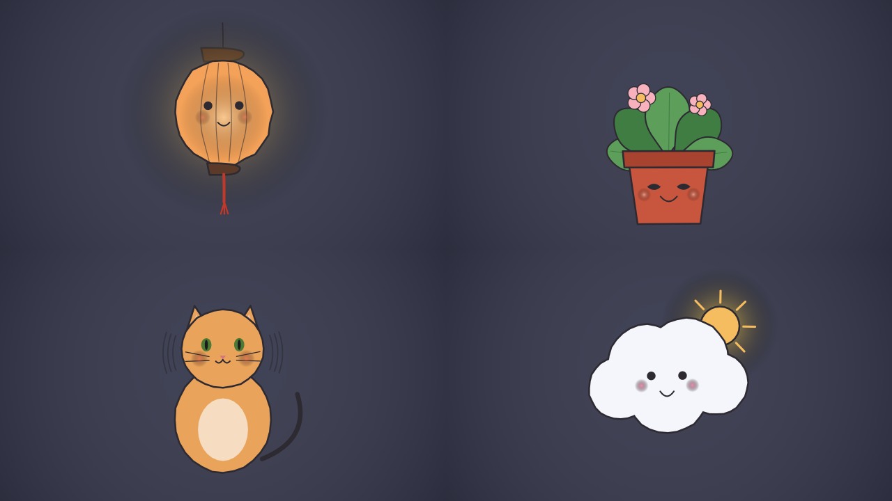
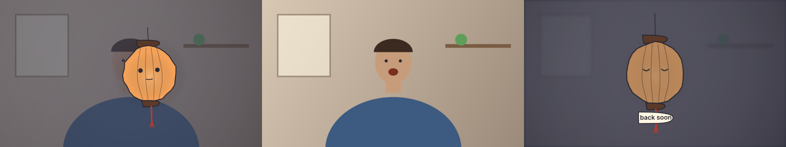
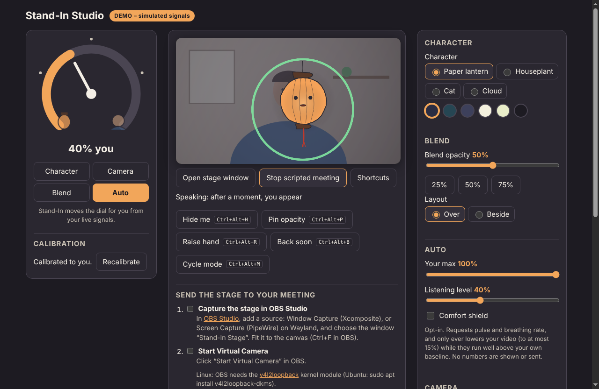

*This is a submission for the [Presage SmartSpectra SDK Challenge](https://dev.to/challenges/presage-2026-11-04).*

## What I Built

**Stand-In Studio** turns the camera-off button into a **dial**.

Video calls ask us to look at our own face, and be looked at, for hours. Research on "Zoom fatigue" names close-up gaze and constant self-view among the causes:
- Bailenson (2021), *Nonverbal Overload: A Theoretical Argument for the Causes of Zoom Fatigue*, Technology, Mind, and Behavior 2(1), [doi:10.1037/tmb0000030](https://doi.org/10.1037/tmb0000030).
- Fauville et al. (2021), *Zoom Exhaustion & Fatigue Scale*, Computers in Human Behavior Reports 4, 100119, [doi:10.1016/j.chbr.2021.100119](https://doi.org/10.1016/j.chbr.2021.100119).

Today the only escape is turning the camera off. A black tile loses every nod and smile that speakers, teachers and teammates rely on. And switching the camera back on to say one thing feels like stepping onto a stage.

Stand-In Studio is a desktop camera with one control, a **presence dial**:
- At one end is your real webcam.
- At the other is a hand-drawn character (a **paper lantern, a houseplant, a cat or a cloud**) that carries your nonverbal cues without your face. It breathes when you breathe, blinks when you blink, nods along, talks when you talk, and glows when you smile.
- In between, your real video fades softly beneath the character.

In **Auto**, the app moves the dial for you:
- you **appear when you speak**;
- the character **covers for you** when you look away, eat, step out or need a moment.

The stage reaches Zoom, Meet or Teams through **OBS Virtual Camera**.





It is meant to be delightful to look at: picture a grid of breathing houseplants and nodding lanterns, with a real face fading in whenever someone speaks. It is also meant to be a thoughtful tool for people who are camera-tired, camera-shy, neurodivergent, sharing a home, eating at their desk, or simply having a hard day.

## Demo

<!-- TODO before publishing: replace with your recorded demo video (YouTube or similar). -->
**🎬 Demo video: _[add your video link here]_**

A 30-second screen recording of the built-in **scripted meeting** (Demo mode) is in the repo at [`docs/media/demo.webm`](https://github.com/SweaDev/stand-in-studio/blob/main/docs/media/demo.webm). It shows Auto end to end:
- listening;
- an enthusiastic double nod;
- talking with a laugh (sparkles);
- a head shake;
- looking away;
- eating at the desk;
- stepping out ("back soon");
- a wake-up stretch.



**Try it without a camera or API key:** run `npm start`, then choose *Try Demo mode*. Use the keys <kbd>N</kbd> nod · <kbd>S</kbd> shake · hold <kbd>T</kbd> to talk · <kbd>H</kbd> smile · <kbd>E</kbd> eat · <kbd>L</kbd> look away · <kbd>A</kbd> step away, or press **Play scripted meeting**.

## Code



Setup, OBS instructions, hotkeys and tests are in the README. The essentials:

```bash
npm ci
PRESAGE_API_KEY=your-key npm start   # or just `npm start` for Demo mode
```

- Built with Electron 45, TypeScript and `@smartspectra/node-sdk` 3.5.0, using the renderer SDK on the app's own camera stream.
- Developed and tested on Ubuntu 24.04. The SDK also supports Windows x64 and Apple-Silicon macOS, which the code targets but which I did not test.

## How It Responds to Human Signals

Stand-In Studio opens the webcam **once** and gives that same stream to the SDK with `sdk.useMediaStream(stream)`. The app draws its own feed from the stream, so there is no `videoOutput` listener. Each signal has exactly one job, and everything is measured **relative to a 15-second calibration**: "look at the screen as you normally would, then nod once and smile once".

| SmartSpectra signal | What the character does | Details |
|---|---|---|
| Chest breathing waveform (`breathing.upperTrace`) | The body gently swells and settles (lantern ribs widen, plant leaves rise, cloud puffs expand) | Normalised to its own 10th–90th percentile over 15 s; scale 1 ± 3.5%. With no fresh samples for 2 s, a soft 12/min idle breath keeps it alive |
| Blinking (`face.blinking`), with eye openness from landmarks as backup | Eyes blink | Rising edge, 140 ms blink, 250 ms refractory period |
| Face landmarks → head pitch and yaw | Nods, shakes, head tilt, **amplified ×3** so a 5° nod reads on a 320×180 tile | Nose tip against the eye midpoint, divided by eye distance and roll-corrected. A nod is a ≥ 0.05 eye-distance dip that returns within 700 ms; two within 1.5 s is an enthusiastic nod |
| Landmarks → inner-lip gap | Mouth opens and closes | **Only while talking**, so chewing or yawning never looks like speech |
| Talking (`face.talking`) | Mouth animates; a soft **speaking ring** | Tells others who is speaking, even on a muted call |
| Expressions (HAPPY score) | Warm glow: the candle flares, flowers open, the sun peeks out. A laugh (smile plus talking) adds sparkles | Compared with your resting level. On at rest + 0.25 held for 400 ms; off below rest + 0.15 |
| Validation status | Presence: "back soon" when away, then a wake-up stretch | Filtered over 1.5 s, because I measured ~30% non-OK codes even on a good, well-lit clip |

**Auto mode** chooses a target opacity, and the lowest applicable rule wins:
- talking for over 1 s → your max;
- listening → 40%;
- looking away for over 2 s → 0%;
- mouth open without talking for over 1.5 s (eating or yawning) → 0%;
- poor framing → 0%;
- no face for 3 s → 0%.

It then moves at most 40% per second, after a 2-second hold, with hysteresis on every trigger.

The core rule is the **Auto invariant**: *your body can only make Stand-In show less of you, never more.* Only visible, deliberate cues (talking while facing the screen) can raise the opacity, and never above the max you set. Property-based tests (fast-check) check this over thousands of random signal combinations.

The opt-in **Comfort shield** is the only feature that requests cardio metrics (pulse and breathing rate). It learns your baseline over its first 30 seconds. While your pulse runs more than 12 bpm above that baseline, or your breathing rate more than 5/min above it, it caps your video at 15%, and it releases after 20 s back near baseline. It is slow by design, because cardio values are averaged over seconds.

A few things I learned by measuring the SDK instead of guessing (all written up in [`docs/sdk-notes.md`](https://github.com/SweaDev/stand-in-studio/blob/main/docs/sdk-notes.md)):
- **Landmarks:** 478 MediaPipe Face Mesh points, in pixel coordinates.
- **Vulkan:** the expression models need it (`mesa-vulkan-drivers` on a headless Linux box).
- **Frame rate:** about 30 packets/s at 1280×720, 960×540 and 640×360.
- **Resolution:** at 640×360 a face that isn't close to the camera is no longer found. So the app captures at 960×540 and steps down only when the SDK reports a sustained low frame rate.

## Prize Categories

I'm entering **both**:

- **Most Creative or Delightful Use:** your breath, blinks, nods, words and smiles become a little paper lantern bobbing on its string, a houseplant whose flowers open when you smile, a cat that purrs, and a cloud with the sun peeking out. A gallery of them makes a meeting feel warmer, not emptier.
- **Best Thoughtful Real-World Use:** the black camera-off tile becomes something kinder. People can stay *present* without being *watched*. The design guarantees that body signals can only reduce exposure, never increase it. It includes reduced-motion and high-contrast styles, a fully keyboard-operable UI checked with axe-core, global hotkeys (*Hide me* always wins), and honest consent.

## Consent and Data Handling

The first screen is a plain-language **consent screen**, and the camera starts only after you click *Start with my camera*. It says:

- **What the meeting receives:**
  - **Character mode** sends only the drawn character to the meeting.
  - **Camera, Blend and Auto** send **your real video**, at the opacity shown on the dial, through OBS.
- **What is read, and why:**
  - face landmarks (head pose, mouth opening), blinking, talking, expressions, chest breathing and framing/validation;
  - these move the character and the dial, nothing else.
- **Cardio, only on opt-in:** pulse and breathing rate are requested only if you switch on the Comfort shield, and are used only to *lower* how much of you is shown.

**Storage, sharing, retention and deletion:**
- **Stored:** only your character and mode settings, in `settings.json` in the app's user-data folder.
  - The settings schema drops anything else.
  - Delete that file to reset.
- **Never stored:** video, images, audio, landmarks or signal values. Nothing is recorded.
- **Calibration** lives in memory and is discarded on quit.
- **No numbers anywhere:** no physiological number is shown on the stage or sent anywhere. The only output is the composed picture, which goes through OBS, under your control.
- **No labels:** the app never labels feelings ("you seem stressed"). It mirrors visible movement and moves the dial.

**Processing and telemetry:**
- **On-device:** frames are processed on your computer by the SmartSpectra SDK.
- **Telemetry off:** the SDK is configured with `enableTelemetry: false` (see Presage's [Telemetry and Privacy](https://smartspectra.presagetech.com/docs/telemetry-and-privacy) page). Presage is contacted only to validate the API key.
- **API key:**
  - It is held only in Electron's main process, in memory.
  - It comes from an environment variable or is pasted in the app.
  - It is never written to disk and never reaches the web page. The SDK's IPC bridge receives it in main, and an end-to-end test checks the page can't see it.
- **No AI services:** no external AI services are used.

**The rest:**
- **Stopping:** you can stop the camera at any time, and *Hide me* (Ctrl+Alt+H) instantly shows only the character.
- **Honest residual risk:** others might notice your video fading and wonder why. Fades have many everyday causes (listening, looking away, eating, stepping out), and the Comfort shield is off by default.
- **Not medical:** no medical or wellness claims, and no diagnosis.

## Agent Session

<!-- TODO before publishing: upload the transcript at https://dev.to/agent_sessions/new, check it for keys and personal data, click "Make Public", then paste the link. -->
This project was planned and built with **Claude Code**, working task by task from a written plan ([PLAN.md](https://github.com/SweaDev/stand-in-studio/blob/main/PLAN.md) and [TASKS.md](https://github.com/SweaDev/stand-in-studio/blob/main/TASKS.md)). Each step was a small, tested commit, and every live SDK run was metered against a 15-minute budget. The total was about 5½ minutes, logged in [IMPLEMENTATION_NOTES.md](https://github.com/SweaDev/stand-in-studio/blob/main/IMPLEMENTATION_NOTES.md).

**Agent session:** _[add the public agent-session link here]_

---

*Credits: [Presage SmartSpectra SDK](https://smartspectra.presagetech.com/docs/). Live tests use a public-domain NIOSH interview clip from Wikimedia Commons, downloaded at test time and never committed.*
