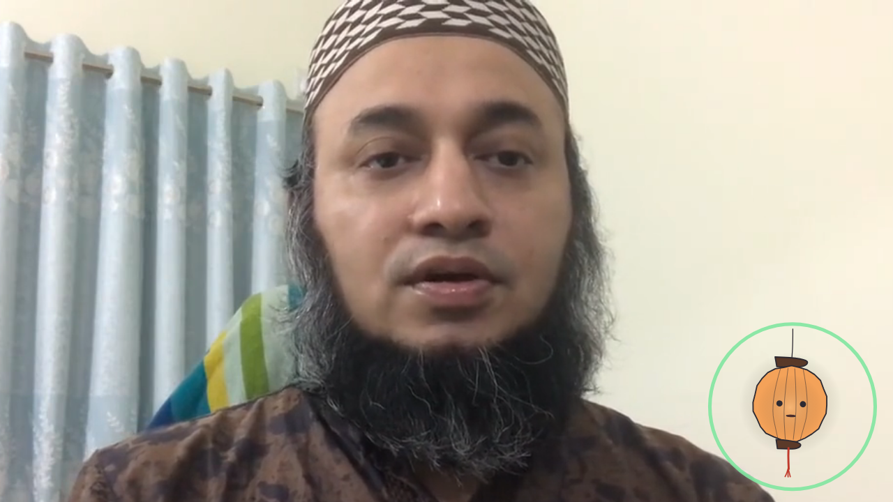
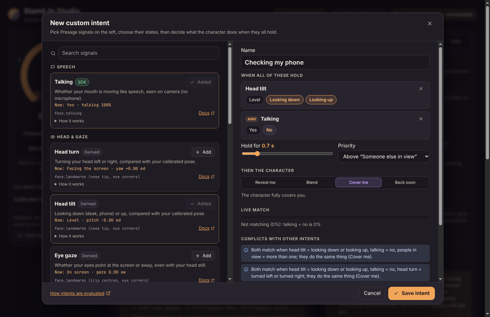

*This is a submission for the [Presage SmartSpectra SDK Challenge](https://dev.to/challenges/presage-2026-11-04).*

## What I Built

Every video call gives you the same two choices: be fully on camera, or be a black tile. I wanted something in between, and I wanted it to take care of itself.

**Stand-In Studio** replaces the camera-off button with a **presence dial**, and then turns the dial for you. It watches what you're doing with the Presage SmartSpectra SDK and decides, moment to moment, how much of you the meeting gets to see.

This isn't just me being camera-shy. Research on "Zoom fatigue" points to close-up eye contact and staring at your own face all day as part of what wears people out:
- Bailenson (2021), *Nonverbal Overload: A Theoretical Argument for the Causes of Zoom Fatigue*, Technology, Mind, and Behavior 2(1), [doi:10.1037/tmb0000030](https://doi.org/10.1037/tmb0000030).
- Fauville et al. (2021), *Zoom Exhaustion & Fatigue Scale*, Computers in Human Behavior Reports 4, 100119, [doi:10.1016/j.chbr.2021.100119](https://doi.org/10.1016/j.chbr.2021.100119).

But switching the camera off has a cost too. Everyone loses your nods and smiles, and turning it back on just to say one sentence feels like walking onto a stage.

So here's how the dial works:
- At one end is your real webcam.
- At the other is a hand-drawn character: a **paper lantern, a houseplant, a cat or a cloud**. It carries your body language without showing your face. It breathes when you breathe, blinks when you blink, nods along, moves its mouth when you talk and glows when you smile.
- In between, the character **sits right over your face** and your real video shows through it. Turn the dial up and the character fades as more of you comes through.

The character finds your face using the face mesh Presage returns, and sizes itself to **your face on screen**, so at 100% it just covers it. You can make it smaller, nudge it around, and cap how opaque it gets.


### The automatic part

The dial is nice, but nobody wants to fiddle with a dial during a meeting. That's what **Auto** is for. It reads your signals from SmartSpectra, works out what you're probably doing (I call these **intents**), and moves the dial on its own:
- When you **talk to the meeting**, you appear.
- While you **listen**, you fade to a comfortable listening level, with the character over your face.
- When you **turn to talk to someone in the room**, look away, eat, step out or just need a moment, the character **covers you** completely.


You decide what happens for each intent, and you can build your own. One rule is baked in and can't be changed: **your body can only make Stand-In show less of you, never more.** The app only shows more of you when you do something deliberate and visible, like facing the screen and talking.

### Lip-reading zoom

While I was building Auto, I realised it already knows exactly when you're talking to the meeting, and that's the moment someone who reads lips needs to see your face clearly. So there's an accessibility option, off by default: **lip-reading zoom**. When Auto reveals you while you talk, your face goes to 100% (even above your own max), the view zooms in on it, and the character steps aside to a corner. When you stop talking, it zooms back out.



### Getting it into your meeting

Stand-In Studio shows up in Zoom, Meet or Teams as a regular webcam. On Linux that's the built-in **Stand-In Camera**: no OBS needed, just a one-time setup that asks for your password. On any platform you can also use **OBS Virtual Camera**, or screen-share the **Stand-In Virtual Stage** window.

I hope it's fun to look at. Picture a grid of breathing houseplants and nodding lanterns, with a real face fading in whenever someone speaks. But I also built it for people who are camera-tired, camera-shy, neurodivergent, sharing a home, eating at their desk, hard of hearing, or just having a rough day.

## Demo



The video uses a 94-second recording of me in a meeting. Presage analysed it once, live, and I saved it as a demo. Every replay after that drives the app from the saved signals, offline, so Auto makes exactly the same decisions it made live.


The big preview is your **raw input**: camera, video file or demo. The small **Virtual Stage** inset is exactly what the meeting receives. A few things I cared about in the UI:
- **You can always tell what's on.** The status bar shows your input, whether the camera is on, and what Presage is reading. One click turns the camera off (the webcam is released and only your character is shown) or stops Presage.
- **It stays tidy.** The main window shows the essentials, and *Advanced → Interface* lets you add the rest. The Camera tab switches between camera, video file and demos without restarting.
- **Help is built in.** There's a Help tab with every shortcut, and a one-minute interactive tour on first run.

**No camera or API key? You can still try it.** Run `npm start` and choose *Try Demo mode*. Then use the keys <kbd>N</kbd> nod · <kbd>S</kbd> shake · hold <kbd>T</kbd> to talk · <kbd>H</kbd> smile · <kbd>E</kbd> eat · <kbd>L</kbd> look away · <kbd>A</kbd> step away, or press **Play scripted meeting**. There's a 30-second recording of that scripted meeting at [`docs/media/demo.webm`](https://github.com/SweaDev/stand-in-studio/blob/main/docs/media/demo.webm).

**Recorded videos and saved demos** turned out to be my favourite way to tune Auto, because I could replay the same moment as often as I liked:
- **Analysed like a webcam:** with an API key, Presage analyses a video file exactly as it would your camera.
- **Save as demo:** after a privacy notice, the clip plays once and is saved with the signals Presage returned.
- **Replay offline:** the saved signals drive the app in step with the video, with no API key and no credits used.
- **Record and share:** record a demo straight from your webcam and export it as a single `.standin-demo.zip`.


## Code



The README covers setup, camera and OBS instructions, hotkeys and tests. The short version:

```bash
npm ci
PRESAGE_API_KEY=your-key npm start
# or just `npm start` for Demo mode
# for some setup, like default Ubuntu, you may need to use nosandbox mode.
PRESAGE_API_KEY=your-key npm run start:nosandbox
```

It's built with Electron 45, TypeScript and `@smartspectra/node-sdk` 3.5.0, using the renderer SDK on the app's own camera stream. I developed and tested it on Ubuntu 24.04. The SDK also supports Windows x64 and Apple-Silicon macOS, and the code targets them, but I haven't tested on those.

## How It Responds to Human Signals

The app opens your webcam **once** and hands that same stream to the SDK with `sdk.useMediaStream(stream)`. It draws its own video from the stream, so there's no `videoOutput` listener. Each signal has one job, and everything is measured **relative to you**, using a 15-second calibration at the start: "look at the screen as you normally would, then nod once and smile once".

| SmartSpectra signal | What the character does | Details |
|---|---|---|
| Chest breathing waveform (`breathing.upperTrace`) | The body gently swells and settles (lantern ribs widen, plant leaves rise, cloud puffs expand) | Normalised to its own 10th–90th percentile over 15 s; scale 1 ± 3.5%. If no fresh samples arrive for 2 s, a soft 12/min idle breath keeps it alive |
| Blinking (`face.blinking`), with eye openness from landmarks as backup | Eyes blink | Rising edge, 140 ms blink, 250 ms refractory period |
| Face landmarks → head pitch and yaw | Nods, shakes, head tilt, **amplified ×3** so a 5° nod still reads on a 320×180 tile | Nose tip against the eye midpoint, divided by eye distance and roll-corrected. A nod is a ≥ 0.05 eye-distance dip that returns within 700 ms; two within 1.5 s is an enthusiastic nod |
| Landmarks → inner-lip gap | Mouth opens and closes | **Only while talking**, so chewing or yawning never looks like speech |
| Landmarks → **face box** (forehead, chin and cheeks of the mesh) | The character sits over your face, sized so its drawn body covers it; **lip-reading zoom** frames your face | Mapped through the same crop as the video, smoothed (position ~150 ms, size ~500 ms), and held while analysis is paused |
| Landmarks → **eye gaze** (iris centres 468 and 473 against the eye corners) | Feeds the *Looking elsewhere* intent | Measured in eye-widths relative to calibration, so it works at any distance from the camera |
| Talking (`face.talking`) | Mouth animates, plus a soft **speaking ring** | Shows others who's speaking, even on a muted call |
| Expressions (HAPPY score) | A warm glow: the candle flares, flowers open, the sun peeks out. A laugh (smile plus talking) adds sparkles | Compared with your resting level. On at rest + 0.25 held for 400 ms; off below rest + 0.15 |
| Validation status | Presence: "back soon" only after no face is found for 3 s, then a wake-up stretch. **Face in view** and **people in view** (`kMultipleFacesFound`) feed intents | Filtered over 1.5 s, because I measured ~30% non-OK codes even on a good, well-lit clip. A face the SDK rates as poor (cut off at the frame edge, too close, dim) still counts as present. My own clip, with my forehead cut off, taught me that one |

### How Auto decides

Each intent is a handful of conditions on Presage-derived signals, paired with an **action** for the character:
- **Reveal me:** your video at your max, and the character fades away.
- **Blend:** your video at your listening level, under the character.
- **Cover me:** only the character.
- **Back soon:** only the character, with a "back soon" badge.

| Built-in intent (default order) | Conditions | Default action |
|---|---|---|
| Away from the camera | no face in view for 3 s | Back soon |
| Someone else in view | more than one face | Cover me |
| Talking to someone else | talking, head turned to the side | Cover me |
| Turned away | not talking, head turned | Cover me |
| Looking elsewhere | not talking, eyes off screen | Cover me |
| Eating or yawning | not talking, mouth open | Cover me |
| Talking in the meeting | talking, facing the screen, eyes on screen, just you | Reveal me |
| Listening to others | quiet, facing the screen, mouth closed, just you | Blend |

Under the hood, it works a bit like a firewall:
- Each condition gives a soft 0–1 match, and an intent scores as its weakest condition.
- Intents are checked top to bottom. The first one to reach 0.6 wins, and it stays in charge until it drops below 0.4.
- Each intent has its own hold time. Covering you happens straight away, but showing more of you waits another 2 seconds. The dial never moves faster than 40% a second.

And you can make it your own:
- **Change actions:** pick a different action for any intent, turn it off, or reorder the list.
- **Tune:** act an intent out for 6 seconds, so its thresholds fit how *you* move.
- **Build your own:** *Advanced → Create custom intent* opens a builder. It lists every Presage-derived signal with its states and a link to its Presage docs, shows a live meter of how well you match right now, and explains conflicts: a warning when two intents overlap, and an error when one can never win.
- **See why:** **Developer mode** adds a live decision log, with every signal's value and state, every intent's score and the condition holding it back, and the final stage targets. It's on screen only and never saved.



### The one rule

The rule I mentioned earlier is what makes automation safe here: *your body can only make Stand-In show less of you, never more.* Only visible, deliberate cues (talking while facing the screen) can raise your opacity, and never above the max you set. An intent built on a body signal (pulse or breathing rate) can only ever cover you. Property-based tests (fast-check) check this across thousands of random signal combinations.

Lip-reading zoom follows the same rule. It only kicks in once Auto has committed to *Reveal me* (after the 2-second hold), and it never goes above the Comfort shield's cap.

The **Comfort shield** is opt-in, and it's the only feature that asks for cardio metrics (pulse and breathing rate). It learns your baseline in its first 30 seconds. If your pulse runs more than 12 bpm above that, or your breathing rate more than 5/min above it, it caps your video at 15%, and it lets go after 20 seconds back near baseline. It's slow on purpose, since cardio values are averaged over several seconds.

**Camera mode costs nothing.** It's a plain pass-through, so the SDK is **paused** and nothing is analysed. It resumes as soon as you leave, and Auto holds its level until fresh data arrives, so a waking SDK never looks like an empty chair.

### What I learned measuring the SDK

I tried to measure instead of guessing, and wrote it all up in [`docs/sdk-notes.md`](https://github.com/SweaDev/stand-in-studio/blob/main/docs/sdk-notes.md). The highlights:
- **Landmarks:** 478 MediaPipe Face Mesh points, in the analysed frame's pixel coordinates, about 20 times a second. That alone was enough to place a character over a face and zoom in on it.
- **Vulkan:** the expression models need it (`mesa-vulkan-drivers` on a headless Linux box).
- **Frame rate:** about 30 packets/s at 1280×720, 960×540 and 640×360.
- **Resolution:** at 640×360, a face that isn't close to the camera stops being found. So the app captures at 960×540 and only steps down when the SDK reports a sustained low frame rate.
- **Insights are vitals-only:** `requestInsight` covers pulse, HRV and breathing, so intents are computed from landmarks, talking, expressions and validation instead.
- **Shut down cleanly:** the SDK's native callbacks can outlive the JavaScript side. Stopping and destroying every SDK session before quitting got rid of a native abort on exit.

## Prize Categories

I'm entering **both**:

- **Most Creative or Delightful Use:** your breath, blinks, nods, words and smiles become a paper lantern bobbing on its string, a houseplant whose flowers open when you smile, a cat that purrs, or a cloud with the sun peeking out. A gallery of them makes a meeting feel warmer, not emptier.
- **Best Thoughtful Real-World Use:** the black camera-off tile becomes something kinder. You can stay *present* without being *watched*, and the automation is built so body signals can only reduce what others see, never increase it. You decide what each situation does, and you can test it on a saved recording, offline, as often as you like. For people who read lips, an opt-in zoom shows your face clearly whenever you speak. There are also reduced-motion and high-contrast styles, a fully keyboard-operable UI checked with axe-core, global hotkeys (*Hide me* always wins), and honest consent.

## Consent and Data Handling

The first screen is a plain-language **consent screen**, and the camera only starts after you click *Start with my camera*. It leads with five key points and keeps every detail one click away. Here's what it tells you:

- **What the meeting receives:**
  - **Character mode** sends only the drawn character.
  - **Camera, Blend and Auto** send **your real video**, at the opacity shown on the dial, as a camera (the Stand-In Camera or OBS) or a screen share.
- **What's read, and why:**
  - face landmarks (head pose, eye gaze, mouth opening), blinking, talking, expressions, chest breathing, and whether a face (or more than one) is in view;
  - these move the character and, through the Auto intents, the dial. Nothing else.
- **Camera mode:** the Presage SDK is paused, so your video passes straight through and nothing is analysed.
- **Cardio, only if you opt in:** pulse and breathing rate are requested only when you turn on the Comfort shield (or a custom intent that uses them), and they're only ever used to *lower* how much of you is shown.

**Storage, sharing, retention and deletion:**
- **What's stored:** your character, mode and intent settings, in `settings.json` in the app's user-data folder.
  - The settings schema drops anything else.
  - Delete that file to reset.
  - Opt-in only, behind a privacy warning: the thresholds learned from intent tuning. Turning the option off deletes them.
- **Nothing is recorded unless you ask:** no video, images, audio, landmarks or signal values are stored by default. Calibration and tuning live in memory and are thrown away when you quit.
- **Saved demos, only when you ask:**
  - *Save as demo* and *Record a demo* show a privacy notice every time.
  - They save the clip and its face signals (pulse and breathing only if you tick them) to a demo folder on your computer. Nothing is uploaded.
  - You can delete demos in the app.
- **Off switches:** the status bar turns the camera off (releasing the webcam) or stops Presage analysis at any time.
- **Developer mode's decision log** is on screen only: never saved, printed or shown on the stage.
- **No numbers anywhere:** no physiological number is shown on the stage or sent anywhere. The only output is the composed picture, sent as a camera or screen share, under your control.
- **No labels:** the app never labels your feelings ("you seem stressed"). It mirrors visible movement and moves the dial, and that's it.

**Processing and telemetry:**
- **On-device:** frames are processed on your computer by the SmartSpectra SDK.
- **Telemetry off:** the SDK is configured with `enableTelemetry: false` (see Presage's [Telemetry and Privacy](https://smartspectra.presagetech.com/docs/telemetry-and-privacy) page). Presage is contacted only to validate the API key.
- **API key:**
  - It's held only in Electron's main process, in memory.
  - It comes from an environment variable or is pasted into the app.
  - It's never written to disk and never reaches the web page. The SDK's IPC bridge receives it in main, and an end-to-end test checks the page can't see it.
- **No AI services:** the app doesn't use any external AI services.

**And the rest:**
- **Stopping:** you can stop the camera any time, and *Hide me* (Ctrl+Alt+H) instantly shows only the character.
- **Honest residual risk:** people might notice your video fading and wonder why. Fades have plenty of everyday causes (listening, looking away, eating, stepping out), and the Comfort shield is off by default.
- **Not medical:** no medical or wellness claims, and no diagnosis.

## How It Was Built

I planned and built this with **Claude Code**, working task by task from a written plan ([PLAN.md](https://github.com/SweaDev/stand-in-studio/blob/main/PLAN.md) and [TASKS.md](https://github.com/SweaDev/stand-in-studio/blob/main/TASKS.md)). Every step was a small, tested commit, and every live SDK run was metered against a fixed budget and logged in [IMPLEMENTATION_NOTES.md](https://github.com/SweaDev/stand-in-studio/blob/main/IMPLEMENTATION_NOTES.md).

---

## *Credits*

- [Presage SmartSpectra SDK](https://smartspectra.presagetech.com/docs/).
- The demo video and screenshots use a recording of me.
- The demo video's music is original, generated in code with Claude.
- The narration voice is my own voice, cloned with Gemini API.
