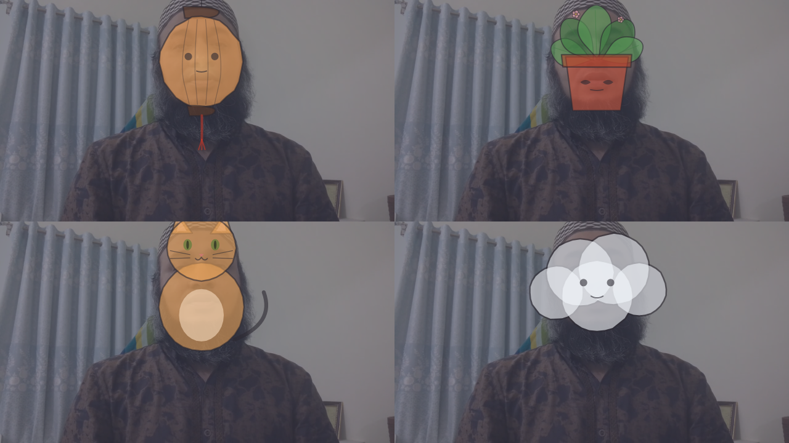
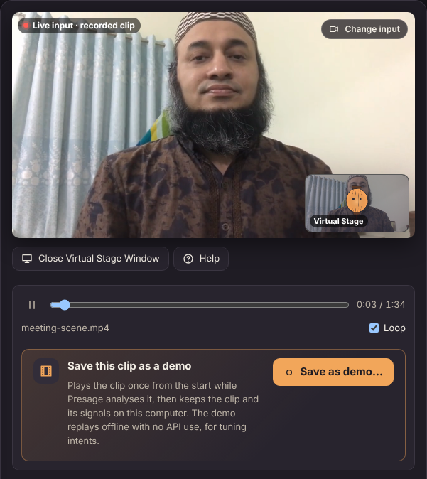

*This is a submission for the [Presage SmartSpectra SDK Challenge](https://dev.to/challenges/presage-2026-11-04).*

## What I Built

**Stand-In Studio** turns the camera-off button into a **dial**.

Video calls ask us to look at our own face, and be looked at, for hours. Research on "Zoom fatigue" names close-up gaze and constant self-view among the causes:
- Bailenson (2021), *Nonverbal Overload: A Theoretical Argument for the Causes of Zoom Fatigue*, Technology, Mind, and Behavior 2(1), [doi:10.1037/tmb0000030](https://doi.org/10.1037/tmb0000030).
- Fauville et al. (2021), *Zoom Exhaustion & Fatigue Scale*, Computers in Human Behavior Reports 4, 100119, [doi:10.1016/j.chbr.2021.100119](https://doi.org/10.1016/j.chbr.2021.100119).

Today the only escape is turning the camera off. A black tile loses every nod and smile that speakers, teachers and teammates rely on. And switching the camera back on to say one thing feels like stepping onto a stage.

Stand-In Studio is a desktop camera with one control, a **presence dial**:
- At one end is your real webcam.
- At the other is a hand-drawn character (a **paper lantern, a houseplant, a cat or a cloud**) that carries your nonverbal cues without your face. It breathes when you breathe, blinks when you blink, nods along, talks when you talk, and glows when you smile.
- In between, the character **sits over your face** and your real video shows through it. As the dial goes up, the character fades and more of you shows.

The character follows your face using the face mesh Presage returns. Its size comes from **your face on screen**, measured against each character's own drawn body, so at 100% it just covers your face. You can make it smaller, nudge it up, down or sideways, and cap how opaque it gets over your face.



In **Auto**, the app moves the dial for you, based on **intents** it reads from your signals:
- you **appear when you talk in the meeting**;
- you **fade to your listening level** while you listen;
- the character **covers you** when you talk to someone else in the room, look away, eat, step out or need a moment.

You choose what the character does for each intent, and you can build your own.


**For people who read lips** there is an accessibility option, off by default: **lip-reading zoom**. While Auto shows you talking to the meeting, your face is shown at 100% (even above your own max) and zoomed in, and the character steps aside to a corner. When you stop talking, it zooms back out.


The stage reaches Zoom, Meet or Teams as a webcam. On Linux it is the built-in **Stand-In Camera**: no OBS needed, and a one-time setup with your password. On every platform, **OBS Virtual Camera** or a screen share of the **Stand-In Virtual Stage** window also work.

It is meant to be delightful to look at: picture a grid of breathing houseplants and nodding lanterns, with a real face fading in whenever someone speaks. It is also meant to be a thoughtful tool for people who are camera-tired, camera-shy, neurodivergent, sharing a home, eating at their desk, hard of hearing, or simply having a hard day.

## Demo

<!-- TODO before publishing: add the demo video link (YouTube or similar). -->
**🎬 Demo video: _[link to be added]_**

The video runs the app on a 94-second recording of me in a meeting. It was analysed once, live, by Presage and saved as a demo. Every replay then drives the app from those saved signals, offline, so Auto makes exactly the decisions it made live.


The big preview shows your **raw input**: camera, video file or demo. The small **Virtual Stage** inset shows exactly what the meeting receives.
- **Always clear what is on:** a status bar shows the input, whether the camera is on and what Presage is reading. One click turns the camera off (the webcam is released and only your character is shown) or stops Presage.
- **Tidy by default:** the main window shows the essentials, and *Advanced → Interface* adds the rest. The Camera tab switches between camera, video file and demos in place.
- **Help built in:** a Help tab with every shortcut, and a one-minute interactive tour offered on first run.

**Try it without a camera or API key:** run `npm start`, then choose *Try Demo mode*. Use the keys <kbd>N</kbd> nod · <kbd>S</kbd> shake · hold <kbd>T</kbd> to talk · <kbd>H</kbd> smile · <kbd>E</kbd> eat · <kbd>L</kbd> look away · <kbd>A</kbd> step away, or press **Play scripted meeting**. A 30-second recording of that scripted meeting is at [`docs/media/demo.webm`](https://github.com/SweaDev/stand-in-studio/blob/main/docs/media/demo.webm).

**Recorded videos and saved demos** make a repeatable test bench for tuning intents:
- **Analysed like a webcam:** with an API key, Presage analyses a video file exactly as it would your camera.
- **Save as demo:** after a privacy notice, the clip plays once and is saved with the signals Presage returned for it.
- **Replay offline:** the saved signals drive the app in step with the video, with no API key and no credits.
- **Record from the app, share as one file:** record a demo straight from your webcam, and export it as a single `.standin-demo.zip`.



## Code



Setup, camera and OBS instructions, hotkeys and tests are in the README. The essentials:

```bash
npm ci
PRESAGE_API_KEY=your-key npm start   # or just `npm start` for Demo mode
```

- Built with Electron 45, TypeScript and `@smartspectra/node-sdk` 3.5.0, using the renderer SDK on the app's own camera stream.
- Developed and tested on Ubuntu 24.04. The SDK also supports Windows x64 and Apple-Silicon macOS, which the code targets but which I did not test.

## How It Responds to Human Signals

Stand-In Studio opens the webcam **once** and gives that same stream to the SDK with `sdk.useMediaStream(stream)`. The app draws its own feed from the stream, so there is no `videoOutput` listener. Each signal has exactly one job, and everything is measured **relative to a 15-second calibration**: "look at the screen as you normally would, then nod once and smile once".

| SmartSpectra signal | What the character does | Details |
|---|---|---|
| Chest breathing waveform (`breathing.upperTrace`) | The body gently swells and settles (lantern ribs widen, plant leaves rise, cloud puffs expand) | Normalised to its own 10th–90th percentile over 15 s; scale 1 ± 3.5%. With no fresh samples for 2 s, a soft 12/min idle breath keeps it alive |
| Blinking (`face.blinking`), with eye openness from landmarks as backup | Eyes blink | Rising edge, 140 ms blink, 250 ms refractory period |
| Face landmarks → head pitch and yaw | Nods, shakes, head tilt, **amplified ×3** so a 5° nod reads on a 320×180 tile | Nose tip against the eye midpoint, divided by eye distance and roll-corrected. A nod is a ≥ 0.05 eye-distance dip that returns within 700 ms; two within 1.5 s is an enthusiastic nod |
| Landmarks → inner-lip gap | Mouth opens and closes | **Only while talking**, so chewing or yawning never looks like speech |
| Landmarks → **face box** (forehead, chin and cheeks of the mesh) | The character sits over your face, sized so its drawn body covers it; the **lip-reading zoom** frames your face | Mapped through the same crop as the video, smoothed (position ~150 ms, size ~500 ms), and held while analysis is paused |
| Landmarks → **eye gaze** (iris centres 468 and 473 against the eye corners) | Feeds the *Looking elsewhere* intent | Measured in eye-widths relative to calibration, so it works at any distance from the camera |
| Talking (`face.talking`) | Mouth animates; a soft **speaking ring** | Tells others who is speaking, even on a muted call |
| Expressions (HAPPY score) | Warm glow: the candle flares, flowers open, the sun peeks out. A laugh (smile plus talking) adds sparkles | Compared with your resting level. On at rest + 0.25 held for 400 ms; off below rest + 0.15 |
| Validation status | Presence: "back soon" only when no face is found for 3 s, then a wake-up stretch. **Face in view** and **people in view** (`kMultipleFacesFound`) for intents | Filtered over 1.5 s, because I measured ~30% non-OK codes even on a good, well-lit clip. A face the SDK rates poor (cropped at the frame edge, too close, dim) still counts as present: my own clip, with my forehead cut off, taught me that |

### Auto mode: intents and actions

Auto is driven by **intents**. Each intent is a few conditions on Presage-derived signals, paired with an **action** for the character:
- **Reveal me:** your video at your max, and the character fades away.
- **Blend:** your video at your listening level, under the character.
- **Cover me:** only the character.
- **Back soon:** only the character, with a "back soon" badge.

| Built-in intent (default order) | Conditions | Default action |
|---|---|---|
| Away from the camera | no face in view for 3 s | Back soon |
| Someone else in view | more than one face | Cover me |
| Talking to someone else | talking, head turned to the side | Cover me |
| Turned away | not talking, head turned | Cover me |
| Looking elsewhere | not talking, eyes off screen | Cover me |
| Eating or yawning | not talking, mouth open | Cover me |
| Talking in the meeting | talking, facing the screen, eyes on screen, just you | Reveal me |
| Listening to others | quiet, facing the screen, mouth closed, just you | Blend |

**How a decision is made:**
- **Membership:** each condition gives a soft 0–1 match.
- **Score:** an intent scores its weakest condition.
- **Priority:** intents are checked top to bottom, like firewall rules. The first to reach 0.6 wins, and it holds until it drops below 0.4.
- **Timing:** each intent has its own hold time. Covering you happens at once, while showing more of you waits a further 2 s. The dial moves at most 40% per second.

**Making it yours:**
- **Change actions:** pick a different action for any intent, turn it off, or reorder the list.
- **Tune:** act an intent out for 6 seconds so its thresholds fit how *you* move.
- **Build your own:** *Advanced → Create custom intent* opens a builder.
  - Every Presage-derived signal is listed with its states and a link to its Presage documentation.
  - A live meter shows how well you match right now.
  - Conflicts with other intents are explained: a warning when two overlap, and an error when one can never win.
- **See why:** **Developer mode** adds a live decision log. It shows every signal's value and state, every intent's score and the condition that limited it, and the final stage targets. It is shown on screen only, never saved.


**Camera mode costs nothing.** Camera mode is a plain pass-through, so the Presage SDK is **paused** while you're in it, and nothing is analysed. It resumes the moment you leave, and Auto holds its level until fresh data arrives, so a waking SDK never looks like an empty chair.

**Lip-reading zoom** goes through the same policy: it engages only once Auto has committed to *Reveal me* (after the 2 s hold), and it never goes above the Comfort shield's cap.

The core rule is the **Auto invariant**: *your body can only make Stand-In show less of you, never more.* Only visible, deliberate cues (talking while facing the screen) can raise the opacity, and never above the max you set. An intent that uses a body signal (pulse or breathing rate) can only cover you. Property-based tests (fast-check) check this over thousands of random signal combinations.

The opt-in **Comfort shield** is the only feature that requests cardio metrics (pulse and breathing rate). It learns your baseline over its first 30 seconds. While your pulse runs more than 12 bpm above that baseline, or your breathing rate more than 5/min above it, it caps your video at 15%, and it releases after 20 s back near baseline. It is slow by design, because cardio values are averaged over seconds.

A few things I learned by measuring the SDK instead of guessing (all written up in [`docs/sdk-notes.md`](https://github.com/SweaDev/stand-in-studio/blob/main/docs/sdk-notes.md)):
- **Landmarks:** 478 MediaPipe Face Mesh points, in the analysed frame's pixel coordinates, about 20 times a second. That is enough to place a character over the face and to zoom to it; nothing else is needed.
- **Vulkan:** the expression models need it (`mesa-vulkan-drivers` on a headless Linux box).
- **Frame rate:** about 30 packets/s at 1280×720, 960×540 and 640×360.
- **Resolution:** at 640×360 a face that isn't close to the camera is no longer found. So the app captures at 960×540 and steps down only when the SDK reports a sustained low frame rate.
- **Insights are vitals-only:** `requestInsight` covers pulse, HRV and breathing, so intents are computed from landmarks, talking, expressions and validation.
- **Shut down cleanly:** the SDK's native callbacks can outlive the JavaScript side. The app stops and destroys every SDK session before it quits, which removed a native abort on exit.

## Prize Categories

I'm entering **both**:

- **Most Creative or Delightful Use:** your breath, blinks, nods, words and smiles become a little paper lantern bobbing on its string, a houseplant whose flowers open when you smile, a cat that purrs, and a cloud with the sun peeking out. A gallery of them makes a meeting feel warmer, not emptier.
- **Best Thoughtful Real-World Use:** the black camera-off tile becomes something kinder. People can stay *present* without being *watched*. The design guarantees that body signals can only reduce exposure, never increase it. You decide what each situation does, and you can test that on a saved recording, offline, as often as you like. For people who read lips, an opt-in zoom shows your face clearly whenever you speak. It also has reduced-motion and high-contrast styles, a fully keyboard-operable UI checked with axe-core, global hotkeys (*Hide me* always wins), and honest consent.

## Consent and Data Handling

The first screen is a plain-language **consent screen**, and the camera starts only after you click *Start with my camera*. Five key points come first, with every detail one click away. It says:

- **What the meeting receives:**
  - **Character mode** sends only the drawn character to the meeting.
  - **Camera, Blend and Auto** send **your real video**, at the opacity shown on the dial, as a camera (the Stand-In Camera or OBS) or a screen share.
- **What is read, and why:**
  - face landmarks (head pose, eye gaze, mouth opening), blinking, talking, expressions, chest breathing, and whether a face (or more than one) is in view;
  - these move the character and, through the Auto intents, the dial, nothing else.
- **Camera mode:** the Presage SDK is paused, so your video passes straight through and nothing is analysed.
- **Cardio, only on opt-in:** pulse and breathing rate are requested only if you switch on the Comfort shield (or a custom intent that uses them), and are used only to *lower* how much of you is shown.

**Storage, sharing, retention and deletion:**
- **Stored:** your character, mode and intent settings, in `settings.json` in the app's user-data folder.
  - The settings schema drops anything else.
  - Delete that file to reset.
  - Opt-in only, behind a privacy warning: the thresholds learned from intent tuning. Turning the option off deletes them.
- **Nothing is recorded unless you ask:** no video, images, audio, landmarks or signal values are stored by default. Calibration and tuning live in memory and are discarded on quit.
- **Saved demos, only when you ask:**
  - *Save as demo* and *Record a demo* show a privacy notice every time.
  - They save the clip and its face signals (pulse and breathing only if you tick them) to a demo library folder on your computer, never uploaded.
  - You can delete demos in the app.
- **Off switches:** the status bar turns the camera off (the webcam is released) or stops Presage analysis at any time.
- **Developer mode's decision log** is on screen only: never saved, printed or shown on the stage.
- **No numbers anywhere:** no physiological number is shown on the stage or sent anywhere. The only output is the composed picture, sent as a camera or a screen share, under your control.
- **No labels:** the app never labels feelings ("you seem stressed"). It mirrors visible movement and moves the dial.

**Processing and telemetry:**
- **On-device:** frames are processed on your computer by the SmartSpectra SDK.
- **Telemetry off:** the SDK is configured with `enableTelemetry: false` (see Presage's [Telemetry and Privacy](https://smartspectra.presagetech.com/docs/telemetry-and-privacy) page). Presage is contacted only to validate the API key.
- **API key:**
  - It is held only in Electron's main process, in memory.
  - It comes from an environment variable or is pasted in the app.
  - It is never written to disk and never reaches the web page. The SDK's IPC bridge receives it in main, and an end-to-end test checks the page can't see it.
- **No AI services:** no external AI services are used.

**The rest:**
- **Stopping:** you can stop the camera at any time, and *Hide me* (Ctrl+Alt+H) instantly shows only the character.
- **Honest residual risk:** others might notice your video fading and wonder why. Fades have many everyday causes (listening, looking away, eating, stepping out), and the Comfort shield is off by default.
- **Not medical:** no medical or wellness claims, and no diagnosis.

## How it was built

This project was planned and built with **Claude Code**, working task by task from a written plan ([PLAN.md](https://github.com/SweaDev/stand-in-studio/blob/main/PLAN.md) and [TASKS.md](https://github.com/SweaDev/stand-in-studio/blob/main/TASKS.md)). Each step was a small, tested commit. Every live SDK run was metered against a fixed budget and logged in [IMPLEMENTATION_NOTES.md](https://github.com/SweaDev/stand-in-studio/blob/main/IMPLEMENTATION_NOTES.md).

---

*Credits: [Presage SmartSpectra SDK](https://smartspectra.presagetech.com/docs/). The demo video and screenshots use a recording of me. Earlier live tests used public-domain clips (a NIOSH interview from Wikimedia Commons and a NASA astronaut interview from the NASA Image and Video Library), downloaded at test time and never committed. The demo video's music is original, generated in code.*
