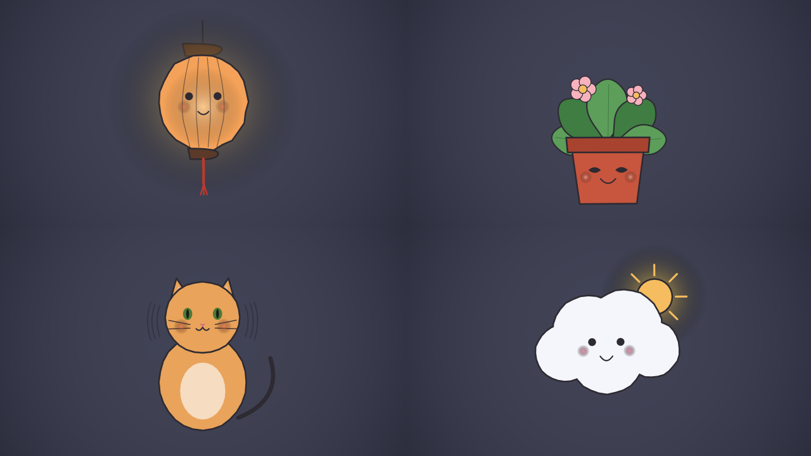
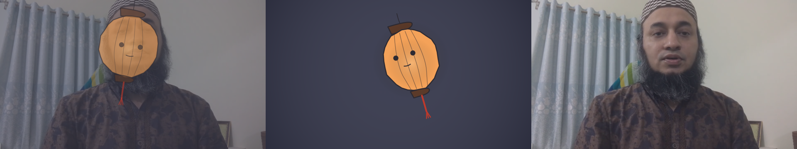
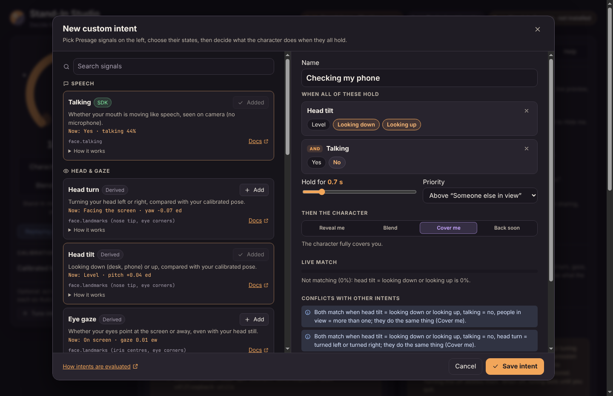
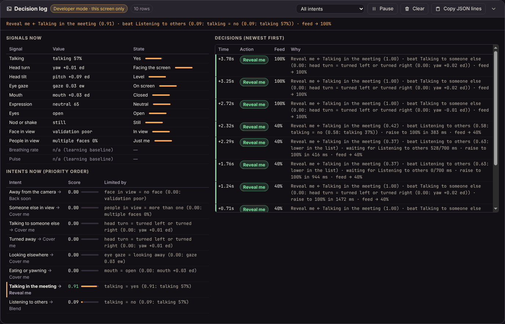

# Stand-In Studio

**Decide how much of you each call sees.**

Stand-In Studio is a desktop camera for video calls with one control: a **presence dial** that runs from *fully you* to *fully stand-in*. At one end is your real webcam. At the other is a hand-drawn character (a paper lantern, a houseplant, a cat or a cloud) that mirrors your nonverbal cues without showing your face:
- it breathes when you breathe and blinks when you blink;
- it nods along and talks when you talk;
- it glows when you smile.

In **Auto**, the app moves the dial for you. You appear when you speak, and the character covers for you when you look away, eat, step out or need a moment.

It is built on the [Presage SmartSpectra SDK](https://smartspectra.presagetech.com/docs/nodejs) (`@smartspectra/node-sdk`) and Electron. It reaches Zoom, Google Meet, Teams or any meeting app as a webcam: the built-in **Stand-In Camera** on Linux (no OBS needed), or **OBS Virtual Camera** or a screen share on any platform.




*Auto mode, left to right: listening (40%), speaking (100%, the character moves to the corner), stepped out ("back soon").*

> 🎬 **Demo video:** _add your demo video link here_. A 30-second recording of the scripted Demo meeting is in [`docs/media/demo.webm`](docs/media/demo.webm).

---

## Contents
- [Features](#features)
- [Requirements](#requirements)
- [Install and run](#install-and-run)
- [Getting a Presage API key](#getting-a-presage-api-key)
- [Sending the stage to your meeting](#sending-the-stage-to-your-meeting)
- [Using the app](#using-the-app)
- [Privacy and consent](#privacy-and-consent)
- [Testing](#testing)
- [Architecture](#architecture)
- [Project files](#project-files)
- [License](#license)

## Features
- **Four modes:**
  - **Character:** the character only.
  - **Camera:** your webcam, optionally with a small character badge.
  - **Blend:** your video at the opacity you choose, with the **Over** or **Beside** layout.
  - **Auto:** the app sets the opacity from your live signals, through **intents** you control.
- **Presence dial:**
  - Turn it to blend. In Auto the needle moves on its own, so you always see what the meeting sees.
  - Changes are eased cross-fades, never cuts.
  - Below 30% your video softly blurs, so it reads as atmosphere rather than a ghostly half-face.
- **Characters** (lantern, houseplant, cat, cloud) are procedural and hand-drawn in style, and stay readable at gallery-tile size. Real cues are **amplified**: a 5° nod becomes a clear 15° character nod.

  | Character | Breathes | Blinks | Nods / shakes | Talks | Smiles | Steps away | Raised hand |
  |---|---|---|---|---|---|---|---|
  | Paper lantern | Ribs widen | Ink-dot eyes | Bobs / sways | Painted mouth | Candle flares | Ember + "back soon" tag | Tassel |
  | Houseplant | Leaves rise | Leaf-eyes | Whole plant nods / leaves sway | Pot-rim mouth | Flowers open | Leaves droop + watering can | Leaf |
  | Cat | Belly rises | Slow cat blink | Head nod / ear flick | "Mew" | Purr lines, rosy cheeks | Curls up asleep | Paw |
  | Cloud | Puffs expand | Eyes close | Dips / wobbles | Soft "O" | Sun peeks out | Fades to mist | Small puff |

- **Live signals from SmartSpectra:**
  - the chest breathing waveform;
  - blinking, with eye openness from landmarks as a backup;
  - face landmarks: head pose for nods and shakes, **iris gaze**, and mouth opening;
  - talking and expressions (happy, surprised, sad, angry, neutral);
  - validation status (face found, more than one face, framing and lighting).
- **15-second calibration.** Everything is measured relative to *you*: neutral head pose, closed mouth, resting expression and blinks.
- **Intent-based Auto** (v1.1, details in [docs/intents.md](docs/intents.md)):
  - Built-in intents, each with an action you choose (*Reveal me*, *Blend*, *Cover me*, *Back soon*):
    - Talking in the meeting → reveal;
    - Listening to others → blend at your listening level;
    - Talking to someone else, Turned away, Looking elsewhere, Eating or yawning, Someone else in view → cover;
    - Away → back soon.
  - Checked top to bottom; the first match wins. Reorder, disable or change any of them.
  - **Custom intents** come from an **intent builder**: a catalogue of every Presage signal with its SDK source, live value and a link to Presage's documentation, plus a live match meter and **conflict warnings** (overlaps, or intents that can never win).
  - **Tune** an intent by acting it out for 6 s, or let **Tune intents to you** walk through the main ones.
  - **Developer mode** adds a live **decision log**: every signal's state, every intent's score and the condition that limited it, the winner and the policy step. It can be filtered, paused and copied as JSON lines.
  - Opt-in **Comfort shield** → capped at 15%.

  Smoothing: at most 40%/s, each intent's own hold (default 0.7 s) with hysteresis, and a further 2 s before showing more of you. Covering is immediate.
  
  *The intent builder: Presage signals with SDK source, live value and docs on the left; conditions, action, live match and conflicts on the right.*

  
  *Developer mode: the live decision log.*
- **Global hotkeys:** Hide me, Pin, Raise hand, Back soon, Cycle mode.
- **Demo mode** with keyboard-driven simulated signals and a 60-second scripted meeting. No camera or API key is needed.
- **Accessibility:**
  - reduced-motion and high-contrast character styles;
  - a fully keyboard-operable UI;
  - axe-core checked, with no serious WCAG A/AA violations.

### The Auto invariant
> *Your body can only make Stand-In show less of you, never more. Numbers never leave your computer.*

Body signals (pulse, breathing rate) can only **lower** the target. An intent that uses one can only cover you, and the Comfort shield is a cap. Raising opacity comes only from intents whose action *you* chose on visible cues (such as talking while facing the screen). It waits 2 s and is always capped by the max *you* set. Property-based tests (fast-check) enforce this in [`tests/unit/core/auto/IntentPolicy.test.ts`](tests/unit/core/auto/IntentPolicy.test.ts).

## Requirements

| | |
|---|---|
| OS | **Linux x64/arm64** (glibc ≥ 2.35, e.g. Ubuntu 22.04+), **Windows x64**, **macOS Apple Silicon**. These are the platforms supported by `@smartspectra/node-sdk`. |
| Node.js | ≥ 20 (developed on Node 22) |
| GPU / Vulkan | The SDK's expression models need **Vulkan**. Desktop GPUs ship drivers. On a headless Linux box or a VM, install Mesa's CPU driver: `sudo apt install mesa-vulkan-drivers` |
| Camera | Any physical webcam. Virtual cameras (OBS, v4l2loopback, the app's own Stand-In Camera and others) are deliberately ignored as input. |
| Linux: v4l2loopback | For the built-in **Stand-In Camera** (`sudo apt install v4l2loopback-dkms v4l2loopback-utils`). The app does the rest once, with your password. |
| OBS Studio | Optional. The way to send the stage on Windows and macOS, and an alternative on Linux; screen sharing works too |
| Presage API key | Needed for live signals. Demo mode works without one. |

> **Tested on:** Ubuntu 24.04 LTS (x86_64; the closest available environment to Ubuntu 26.04), Node 22, Electron 45, with the Chromium fake camera fed a public-domain test clip. Windows and macOS share the same code but were **not** tested. See [IMPLEMENTATION_NOTES.md](IMPLEMENTATION_NOTES.md).

## Install and run
```bash
git clone https://github.com/SweaDev/stand-in-studio.git
```
```bash
cd stand-in-studio
```
```bash
npm ci
```
Run with live signals (the key stays in the main process):
```bash
PRESAGE_API_KEY=your-key npm start
```
Or run without a key (Demo mode, or paste a key in Settings later):
```bash
npm start
```
On Linux, as root or in some containers, Electron needs the sandbox disabled:
```bash
npm run start:nosandbox
```
On Windows (PowerShell), set the key first with `$env:PRESAGE_API_KEY="your-key"`, then run `npm start`.

Force Demo mode even when a key is set with `STANDIN_DEMO=1 npm start`.

## Getting a Presage API key
1. Create a free account at [physiology.presagetech.com](https://physiology.presagetech.com/auth/login) and copy your API key.
2. Either set `PRESAGE_API_KEY` before starting, or open **Settings → Presage API key**, paste it and press **Use key**, then **Restart with my camera**.

The key is held only in the Electron main process, in memory. It is never written to disk and never reaches the page. It is injected into the SDK's IPC bridge in main; see [`src/main/sdkKeyInjection.ts`](src/main/sdkKeyInjection.ts).

## Sending the stage to your meeting
The **Virtual Stage** is the picture the meeting sees: 1280×720 at 30 fps.
- The control window's large preview shows your **raw input**: camera, recorded clip or demo video.
- The small **Virtual Stage** inset in its corner shows what the meeting gets. Click it to open the frameless **"Stand-In Virtual Stage"** window; **Open/Close Virtual Stage Window** toggles it.

There are three ways to send it, all listed in the app under *Send the stage to your meeting*.

### 1. Stand-In Camera (Linux, built in, the default)
A virtual webcam called **Stand-In Camera**: pick it in Meet, Zoom or Teams like any camera. It works even while the Virtual Stage window is closed.
- **Install v4l2loopback once:**
  - Ubuntu or Debian: `sudo apt install v4l2loopback-dkms v4l2loopback-utils`
  - Fedora: `sudo dnf install v4l2loopback kmod-v4l2loopback`
  - Arch: `sudo pacman -S v4l2loopback-dkms v4l2loopback-utils`

  With Secure Boot on, the installer asks you to enrol a signing key on the next reboot.
- **Press "Set up camera" once.** Your system asks for your password (pkexec), and the app then:
  - loads v4l2loopback at every start-up;
  - creates **Stand-In Camera** and **OBS Virtual Camera** devices, so OBS keeps working too;
  - leaves any v4l2loopback options you already have untouched.

  The setup is a short fixed script, [`src/main/vcam/setupScript.ts`](src/main/vcam/setupScript.ts). It never prompts again, even after a reboot.
- **Any source:** it works with your webcam, a recorded video, a saved demo or the simulated demo. The camera sends whatever the Virtual Stage shows; in Camera mode that is the plain clip.
- **On/off:** the camera is on by default and starts by itself once a device exists. Turning it off, or quitting, leaves meeting apps on a "Stand-In paused" picture rather than a frozen frame.
- **How it works:** it is the same technique as OBS's own Linux virtual camera. The stage is converted to YUYV on the GPU (WebGL2) and written to the v4l2loopback device.

### 2. OBS Studio (any platform)
   - Windows: *Window Capture*
   - macOS: *macOS Screen Capture*, method Window Capture
   - Linux X11: *Window Capture (Xcomposite)*
   - Linux Wayland: *Screen Capture (PipeWire)*

   Pick "Stand-In Virtual Stage" and fit it to the canvas (Ctrl+F). The window has no title bar, so the capture stays clean. *Before 1.4 it was called "Stand-In Stage"; pick it again.*
2. **Start Virtual Camera** in OBS.
   - On Linux this needs the v4l2loopback module: `sudo apt install v4l2loopback-dkms`.
3. In **Zoom / Meet / Teams**, choose **OBS Virtual Camera**. The meeting never touches your real webcam, so there is no camera conflict.

### 3. Screen share (any platform)
Share the "Stand-In Virtual Stage" window as a screen share in the meeting.

Use **Show test pattern** to confirm the meeting sees the stage. It shows colour bars, a moving dot and the time.

## Using the app
1. **Start screen:** five key points say what is read, sent and stored, with every detail under *All privacy details*. Then pick how to start:
   - **Your camera** (with a camera picker when you have more than one). The camera starts only after **Start with my camera**.
   - **A video file**, optionally ticking *Save its telemetry as a demo*.
   - **Demo mode**: the simulated person, or one of your saved demos.

   On first run, a small card offers a one-minute **tour** of the main window. Take it again any time from **Help**.
2. **Calibration (15 s):**
   - sit so your face and upper chest are in view;
   - look at the screen as you normally would;
   - nod once, then smile once.

   **Recalibrate** at any time.
3. **Pick a mode** or turn the **presence dial**:
   - In **Auto**, set *Your max* (default 100%) and *Listening level* (default 40%).
   - Optionally switch on the **Comfort shield**.
   - Review the **intents** in the Auto tab: change actions, reorder, disable, or press **Tune** to fit one to you.
   - **Advanced → Create custom intent** opens the builder. **Advanced → Developer mode** shows the decision log.
4. **Characters and accessibility:**
   - choose a character and background colour;
   - **Follow my face** (on by default): in Blend and Auto the character sits over your face, using the face position Presage reads. *Size* 100% means its body just covers your face on screen, and you can go down to 25%. You can also nudge it left, right, up or down, and cap its *Opacity over face*. Its opacity mirrors the dial: at 40% you, the character is at 60%;
   - turn on *Reduced motion* or *High contrast* if you like;
   - **Lip-reading zoom (Auto)**, off by default: while Auto shows you talking to the meeting, your face is shown at 100% (above *Your max*) and zoomed in, and the character steps aside to a corner. It is for people who read lips.
5. **Presets:** save your mode and levels as a meeting preset, such as "Stand-up: Auto, listening 30%".

### The main window
- **Status bar** (top right): what feeds the stage, whether your **camera** is on, what **Presage** is reading (for example *Presage · Integrated Webcam* or *Presage · talk.webm*), and the **Stand-In Camera**.
  - Click **Camera** to turn it off: the webcam is released, Presage stops, and the meeting sees only your character until you turn it back on.
  - Click **Presage** to stop or resume analysis while the camera keeps running. Auto holds its level meanwhile.
- **Camera tab:** switch the input between **Camera**, **Video file** and **Demo** (simulated or a saved demo) in place, without going back to the start screen. It also has the camera and resolution, what Presage is reading with its on/off switch, *Record a demo*, the API key and *Back to start screen*. *Change input* on the preview opens it.
- **Essentials by default:** the dial, modes, live preview, *Hide me*, the status bar, calibration and the ways to send the stage. **Advanced → Interface** adds the other override buttons (Pin, Raise hand, Back soon, Cycle mode), the intent list and builder, and can hide calibration, the send-to-meeting section or presets. Every hotkey works whatever is shown.
- **Help tab** (or <kbd>F1</kbd> / <kbd>?</kbd>): getting started, the modes, every keyboard shortcut, how to send the stage, privacy in brief, and **Take the tour**.

### Recorded videos and saved demos
Recorded clips are a way to test and tune intents on the same footage again and again.
- **A video file** (start screen, or **Camera tab → Video file**) plays an MP4, WebM, MOV, MKV or OGV file in place of the camera. All four modes work on it: Camera passes it through, and Character, Blend and Auto follow it. With an API key, Presage analyses the clip exactly as it would your webcam.
- **Save this clip as a demo** (the card under the clip's controls, or *Save its telemetry as a demo* on the start screen) plays the clip once from the start and saves the clip together with the signals Presage returned for it. The card shows REC and a progress bar while it saves, then *Play it now*.
- **Record a demo…** (Camera tab) records your webcam together with its live telemetry.
- **Saved demos replay offline.** Pick one under *Demo mode* on the start screen or in **Camera tab → Demo**, or press *Play* in Advanced → Demo library. The saved telemetry drives the engine in step with the video, so no API key or credits are used, and Auto decides exactly as it did live.
- **Where demos are kept:** the **Demo library** folder, `demos/` inside the app's user-data folder by default. You can choose another folder in Advanced. Because it is outside the app, saved demos survive rebuilds and reinstalls. Demos are never part of this repository.
- **Sharing:** **Export** in Advanced → Demo library writes three files:
  - `<name>.standin-demo.zip`, one file to share, which holds the video, `telemetry.json` and `meta.json`;
  - the video and `<name>.telemetry.json` as loose copies, to inspect.

  **Import** takes either the `.standin-demo.zip` or a video plus its telemetry file. The zip is a plain stored ZIP, so any unzip tool opens it too.
- **What a demo contains:** you are asked before every save, with a privacy notice.
  - Saved by default: face landmarks, talking, blinking, expressions, and face or people in view.
  - Pulse and breathing: only if you tick the box.
  - Format: [`src/shared/telemetry.ts`](src/shared/telemetry.ts), `standin-telemetry` v1. Each frame is stamped with the clip's media time when Presage delivered it, so a replay includes the SDK's real latency.

### Hotkeys (global, work while your meeting app has focus)

| Action | Linux / Windows | macOS |
|---|---|---|
| Hide me (instant 0%, wins until pressed again) | Ctrl+Alt+H | ⌘⌥H |
| Pin (freeze the current opacity) | Ctrl+Alt+P | ⌘⌥P |
| Raise hand | Ctrl+Alt+R | ⌘⌥R |
| Back soon | Ctrl+Alt+B | ⌘⌥B |
| Cycle mode | Ctrl+Alt+M | ⌘⌥M |

### Demo mode keys (in the control window)
- <kbd>N</kbd> nod · <kbd>S</kbd> shake · <kbd>T</kbd> hold to talk · <kbd>B</kbd> blink · <kbd>H</kbd> smile
- <kbd>E</kbd> eat · <kbd>L</kbd> look away · <kbd>O</kbd> talk to someone off to the side · <kbd>A</kbd> step away · <kbd>P</kbd> raise the Comfort-shield trigger
- **Play scripted meeting** runs a 60-second loop showing Auto end to end.

The status bar shows **Simulated demo** (or **Saved demo · name**) in the control window. It never appears on the stage.

## Privacy and consent
- **Camera mode uses no API:** in Camera mode the Presage SDK is paused (after a 1.5 s debounce, so cycling modes doesn't stop and restart it), and nothing is analysed. It resumes when you leave Camera mode.
- **On-device:** frames are processed on this computer by the SmartSpectra SDK. Stand-In Studio records and stores **nothing** unless you ask: no video, images, audio, landmarks or signal values.
- **Camera and Presage switches:** the status bar turns the camera off (privacy shutter: the webcam is released and only the character is shown) or stops Presage analysis, at any time.
- **Saved demos are opt-in:** *Save as demo* and *Record a demo* ask first, with a privacy notice. They then save the clip and its face signals (plus pulse and breathing only if ticked) in your demo library folder on this computer. Nothing is uploaded, and you can delete demos in Advanced → Demo library. Replaying a saved demo uses no API.
- **What is saved:** only character, mode and intent settings (names, conditions, actions, order), in `settings.json` in the app's user-data folder.
  - The settings schema drops anything else, including keys and numbers.
  - Calibration and intent tuning live in memory and are discarded on quit.
  - Opt-in only (Advanced, with a privacy warning): the thresholds learned from tuning recordings, which are averages of head turn, gaze, mouth and expression and never video. Turning the option off deletes them.
  - The developer-mode decision log is on-screen only: never saved, printed or shown on the stage.
- **Minimal requests:**
  - face landmarks, blinking, talking, expressions and chest breathing;
  - **pulse and breathing rate only while the Comfort shield or a body-signal intent is on**, and used only to *lower* the dial.
- **Telemetry off:** the SDK runs with `enableTelemetry: false`. See Presage's [Telemetry and Privacy](https://smartspectra.presagetech.com/docs/telemetry-and-privacy) page.
- **No numbers, no labels:** no physiological number is shown on the stage or sent anywhere, and the app never labels feelings. The only output is the composed picture, sent through the Stand-In Camera, OBS or a screen share, under your control.
- **Honest residual risk:** others might notice your feed fading and wonder why. Fades have many everyday causes, and the Comfort shield is off by default.
- **Not medical:** no medical or wellness claims, and no diagnosis.

## Testing

| Command | What it runs |
|---|---|
| `npm test` | ESLint, Prettier check, TypeScript type-check, and **Vitest** unit and property tests ( tests; about 98% line coverage of the pure core) |
| `npm run test:e2e` | **Playwright + Electron** end-to-end tests under `xvfb-run`: consent gating, stage window, Demo-mode Auto flow, dial, settings, hotkeys, OBS checklist, API-key isolation, camera manager (fake device), presets, axe-core accessibility |
| `npm run test:live` | The real app with the **real SDK** for 60 s, using a Chromium fake camera fed a public-domain clip. It checks that metrics, landmarks, breathing and `kOk` arrive, that calibration completes, and that Auto shows the talking speaker. Needs `PRESAGE_API_KEY`, `./scripts/fetch-test-video.sh` and Vulkan. Each run is metered by `scripts/presage-budget.mjs` (15-minute cap). |
| `npm run presage:budget` | Shows Presage SDK time used by live runs |
| `node scripts/live-recorded.mjs <clip> [outDir]` | Plays a recorded clip through the real SDK, saves its telemetry, then replays it on the next launch with no API key, and compares the intents. Budget-guarded. |
| `node scripts/live-probe.mjs 40` | Main-process SDK probe on the test clip: prints field shapes and counts, never values |

CI ([`.github/workflows/ci.yml`](.github/workflows/ci.yml)) runs `npm test` and the e2e suite on Ubuntu 24.04. It never runs live tests.

## Architecture

```
main process ─────────────── windows, global hotkeys, settings.json (sanitized), API key (memory only),
  │                          SmartSpectra IPC bridge with the key injected (Decorator)
  │ IPC (contextBridge: window.studio + the SDK's preload bridge)
control renderer ─────────── one getUserMedia stream ──► SmartSpectra renderer SDK (useMediaStream)
  │                                   │                        │ metrics / validation
  │                                   │                 PresageSignalSource | DemoSignalSource  (Adapter)
  │                                   │                        ▼
  │                                   │                 StudioEngine (Facade, pure TS, injected Clock)
  │                                   │                   features → trackers → PoseMapper
  │                                   │                   signals → intents (first match) → IntentPolicy → ModeController (State)
  │                                   │                   → OpacitySmoother → StageState
  │                                   ▼                        ▼
  └── window.open('about:blank') ─► "Stand-In Virtual Stage" canvas ◄─ StageCompositor + Character (Strategy/Registry)
```

- **Pure core** (`src/core`): calibration, landmark features, trackers (breathing, blink, nod/shake, smile, talking, presence, validation filter), pose mapper, intents (signal readings, matcher and tracker, tuning, conflict analysis, decision trace), the intent policy, Comfort shield, smoother and modes. It has no Electron, SDK or DOM dependency (enforced by ESLint) and is fully unit-tested with a `FakeClock`.
- **Sensing** (`src/sensing`): the SDK adapter, the metrics → `SignalFrame` mapper, the minimal metric request builder, the camera filter and Demo mode.
- **Rendering** (`src/render`): seeded hand-drawn sketch primitives, the four characters and the stage compositor (layers: background → feed at α with blur below 30% → character → badges).
- **App** (`src/main`, `src/preload`, `src/renderer`): the Electron shell and small DOM components.

Design patterns used:
- Adapter: signal sources
- Strategy: landmark layouts, characters; intents are data (conditions over a signal catalogue)
- State: modes, calibration, presence
- Observer: typed emitter
- Command: hotkeys
- Factory/Registry: characters
- Facade/Mediator: `StudioEngine`, `ControlApp`
- Decorator: SDK key injection
- Dependency injection: `Clock`

Measured SDK facts (478 MediaPipe landmarks in pixel coordinates, packet rates, validation flicker, the Vulkan requirement, capture-resolution trade-offs) are in [`docs/sdk-notes.md`](docs/sdk-notes.md).

## Project files
- [REQUIREMENT.md](REQUIREMENT.md): product specification
- [PLAN.md](PLAN.md) and [TASKS.md](TASKS.md): implementation plan and task log
- [IMPLEMENTATION_NOTES.md](IMPLEMENTATION_NOTES.md): reproducibility log (test clip provenance, live-run budget, performance, deviations)
- [docs/sdk-notes.md](docs/sdk-notes.md): measured SDK behaviour
- [POST.md](POST.md): DEV challenge submission
- [CHANGELOG.md](CHANGELOG.md)

## License
[MIT](LICENSE). The SmartSpectra SDK is © Presage Technologies and is subject to its own license. Test media is downloaded at test time and never committed. The test clip is a public-domain NIOSH video (see IMPLEMENTATION_NOTES.md).
